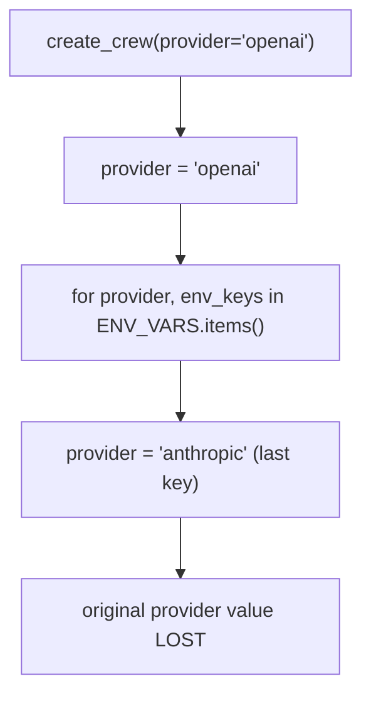
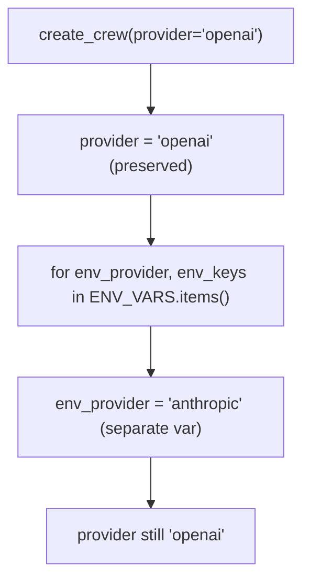

## Issue: Loop Variable Shadows Function Parameter

## Fix: Rename Loop Variable

## PR Description

`create_crew()` accepts a `provider` parameter that callers use to pre-select
a model provider. Inside the function a `for provider, env_keys in
ENV_VARS.items()` loop reuses that same name, which means the parameter value
is silently overwritten by the last key iterated from `ENV_VARS`. Any logic
after the loop that inspects `provider` sees the wrong value.

The fix renames the loop variable to `env_provider` and updates the one
reference to it inside the loop body (`existing_provider = env_provider`).
The parameter name is unchanged and its value is now preserved for the entire
function lifetime.

Fixes #7893
